# Grokking Lab

A small transformer is shown 30% of the addition table modulo 97 and trained on
it for a long time. It memorises those cells almost immediately. Then, for the
next five thousand steps, it looks stuck: held out accuracy crawls from 1% to
10% and the held out loss gets steadily worse. Then, over a few hundred steps,
it jumps to 100% and stays there.

```
accuracy
  100% |      train ____________________________________________
       |          /                                      _______
       |         /                             held out /
    0% |________/_____________________________________ /________
       step 1         100           1,000          10,000
                       ^                              ^
                       memorised what it was shown    understood the rule
```

Memorisation finishes at step 125. Generalisation arrives at step 5,125, forty
one times later. Between the two, training loss is already at the floor and held
out loss is rising, so every number a normal training run watches says the same
thing: this is finished, and it did not work.

This repository reproduces that, and then answers the obvious question: what was
the network doing during the flat part?

It was not doing nothing. A measurement taken from the weights rather than from
the loss climbs steadily through the whole plateau, and it starts climbing long
before the held out accuracy moves. The plateau is an artefact of what we chose
to plot.

<picture>
  <source media="(prefers-color-scheme: dark)" srcset="figures/dark/01_curves.png">
  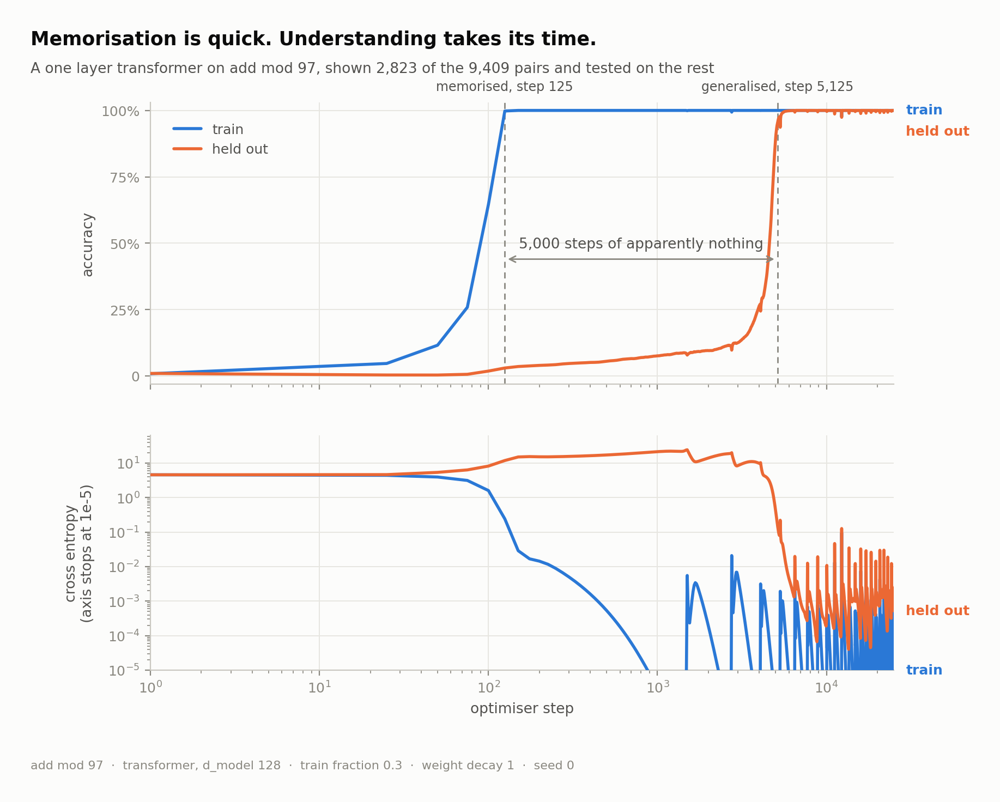
</picture>

## The claim

Modular addition has essentially one cheap solution, and it is trigonometry.
Since

```
cos(w(a + b)) = cos(wa)cos(wb) - sin(wa)sin(wb)
sin(w(a + b)) = sin(wa)cos(wb) + cos(wa)sin(wb)
```

a network can turn two separate inputs into a function of their sum by putting
each input on a circle, composing the rotations, and reading the angle back off.
Nothing else available to a two layer network is anywhere near as compact. So a
network that has understood the task must have waves in its embedding matrix,
and a network that has merely memorised the training cells has no reason to.

That gap is measurable. Take the embedding matrix, transform it into the Fourier
basis of Z_p, and ask what share of its energy sits in its five strongest
frequencies. A random matrix scores about 12%, because the top few of many
noisy frequencies always win something. A network that has found the circular
representation scores close to 1.

<picture>
  <source media="(prefers-color-scheme: dark)" srcset="figures/dark/02_progress.png">
  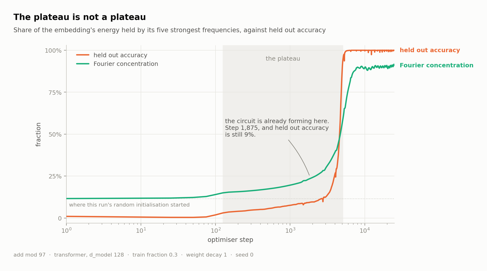
</picture>

The green line is that measurement. It has clearly left the noise floor by step
1,875, when held out accuracy is still 9%. By the time accuracy moves, the
circuit it depends on has been under construction for another 3,250 steps.
Nothing was hidden. We were reading the wrong dial.

## Quickstart

```bash
pip install -r requirements.txt
python -m grokking.train --config configs/quick_mlp.json
```

That trains the two layer baseline on `a + b mod 97`. It memorises in 140 steps,
generalises at 1,300, and takes about 17 minutes on a laptop CPU. Then draw its
figures:

```bash
python -m grokking.figures --run runs/quick_mlp --out figures/quick_mlp
```

The transformer run that this README shows takes longer:

```bash
python -m grokking.train --config configs/headline.json
```

That one took 114 minutes on eight CPU threads with other work running on the
same machine, so budget up to two hours. No GPU is needed anywhere in this
repository. `make help` lists the rest.

## What is in here

```
grokking/
  config.py     one dataclass describing a run, saved next to its results
  data.py       the modular arithmetic tables and their deterministic splits
  model.py      a decoder-only transformer written out by hand, and an MLP
  metrics.py    loss, accuracy, weight norm, and the Fourier progress measure
  fourier.py    the Fourier bases, additive and multiplicative, and the analysis
  train.py      the training loop
  analysis.py   loading a finished run, and the causal ablations
  figures.py    the figure suite, rendered for a light and a dark theme
  sweep.py      running the same config over a range of one setting
  style.py      one visual system for every figure
```

About 2,800 lines in the package and 900 more in `tests/`. The only
dependencies are PyTorch, NumPy and matplotlib.

Nothing is imported from a transformer library. `model.py` spells out the
attention, the layer norm and the residual stream, partly because the analysis
needs intermediate tensors that have names, and partly because the whole model
is 45 lines and hiding it would be a shame. The hand written attention is tested
against `torch.scaled_dot_product_attention`, and the hand written layer norm
against `torch.nn.functional.layer_norm`, so "written out by hand" does not mean
"probably correct".

## The evidence

### The numbers arrange themselves on a circle

Project every token's embedding onto the cosine and sine directions of one of the
frequencies the network chose, and watch across training.

<picture>
  <source media="(prefers-color-scheme: dark)" srcset="figures/dark/04_circle.png">
  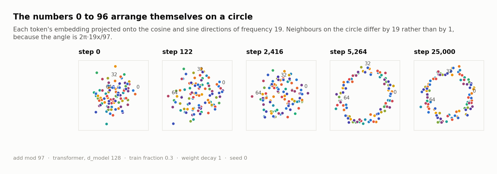
</picture>

At initialisation the tokens are scattered. At the end they sit on a circle at
almost exactly equal angles. Neighbours on that circle are not consecutive
integers, because the angle assigned to token `x` is `2πkx/p`: the circle is the
one the network needs, not the one we would have drawn.

### A few frequencies win, and you can watch it happen

<picture>
  <source media="(prefers-color-scheme: dark)" srcset="figures/dark/03_spectrum.png">
  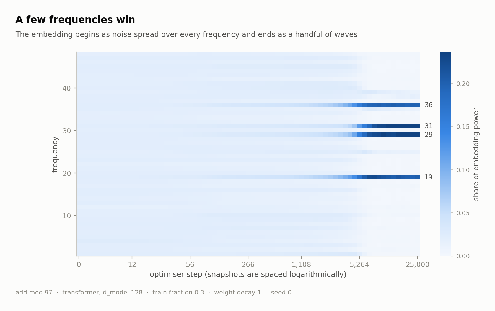
</picture>

Every row is a frequency, every column a moment in training, and the colour is
that frequency's share of the embedding's energy. The field starts as noise and
resolves into a handful of bright lines. The lines are already visible while the
validation loss is still flat.

### Deleting those frequencies destroys the model

A correlation is not a mechanism. So: take the trained network, project its
embedding onto only the key frequencies, and measure. Then project those
frequencies out and measure again.

<picture>
  <source media="(prefers-color-scheme: dark)" srcset="figures/dark/06_ablation.png">
  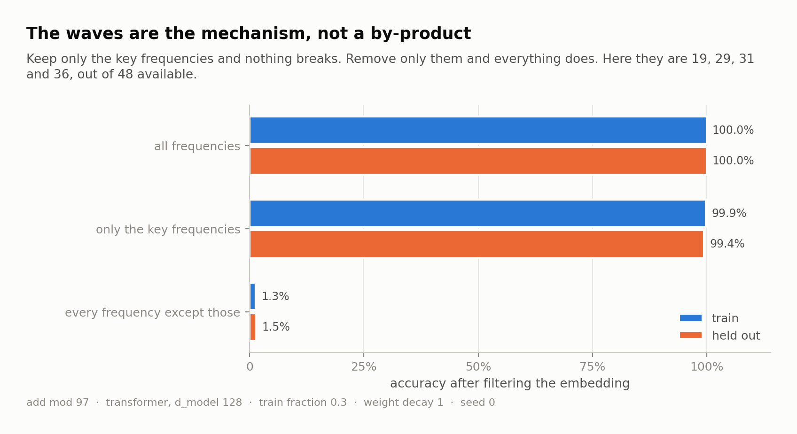
</picture>

Keeping 4 frequencies out of 48 costs 0.6% of held out accuracy. Deleting those
same 4 and keeping the other 44 leaves the model at 1.5%, against a chance rate
of 1%. The waves are not a side effect of having learned the task. They are how
the task is done.

### Each neuron listens to a single frequency

<picture>
  <source media="(prefers-color-scheme: dark)" srcset="figures/dark/07_neurons.png">
  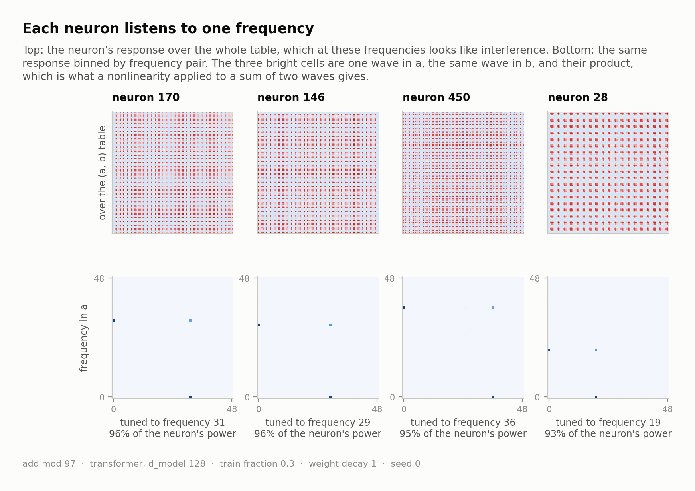
</picture>

Binned by frequency pair, a hidden neuron puts 93% to 96% of its response into a
single frequency, spread over three cells: a wave in `a`, the same wave in `b`,
and their product. That is the signature of a nonlinearity applied to a sum of
two waves, which is what this architecture can actually build; the clean product
the identity calls for is assembled afterwards, when the output layer combines
neurons.

The four neurons above are tuned to 31, 29, 36 and 19. Those are the same four
frequencies the embedding analysis picked out, arrived at from the other end of
the network.

### And the output is a function of the sum

<picture>
  <source media="(prefers-color-scheme: dark)" srcset="figures/dark/08_logits.png">
  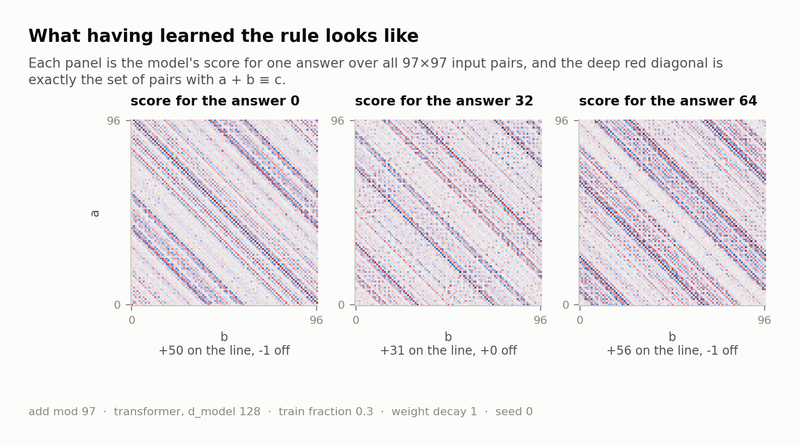
</picture>

The model's score for a given answer, plotted over every input pair, is a set of
diagonal stripes, and diagonal means constant along `a + b`. On the diagonal
where `a + b` really does equal the answer the score averages +50; everywhere
else it averages zero. The fainter stripes either side are the handful of
frequencies the network kept, beating against each other.

### Weight decay is the clock

<picture>
  <source media="(prefers-color-scheme: dark)" srcset="figures/dark/05_phases.png">
  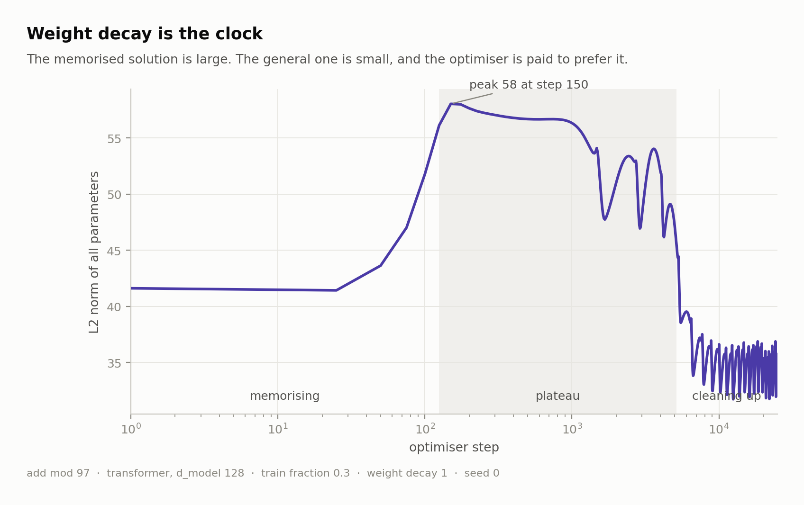
</picture>

The memorised solution is large. The general one is small. AdamW is paid to
prefer small solutions, so once the training loss is flat the only remaining
pressure is toward a smaller network, and the smallest network that fits the
training data is the one that also fits everything else. Remove that pressure and
the run never leaves the plateau:

<picture>
  <source media="(prefers-color-scheme: dark)" srcset="figures/dark/sweep_weight_decay.png">
  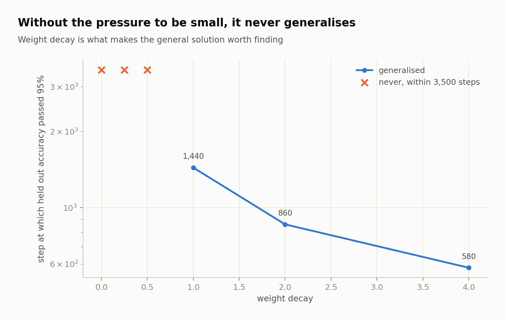
</picture>

Reduce the data instead and the same thing happens for a different reason. There
is a threshold below which the general solution stops being worth finding:

<picture>
  <source media="(prefers-color-scheme: dark)" srcset="figures/dark/sweep_train_frac.png">
  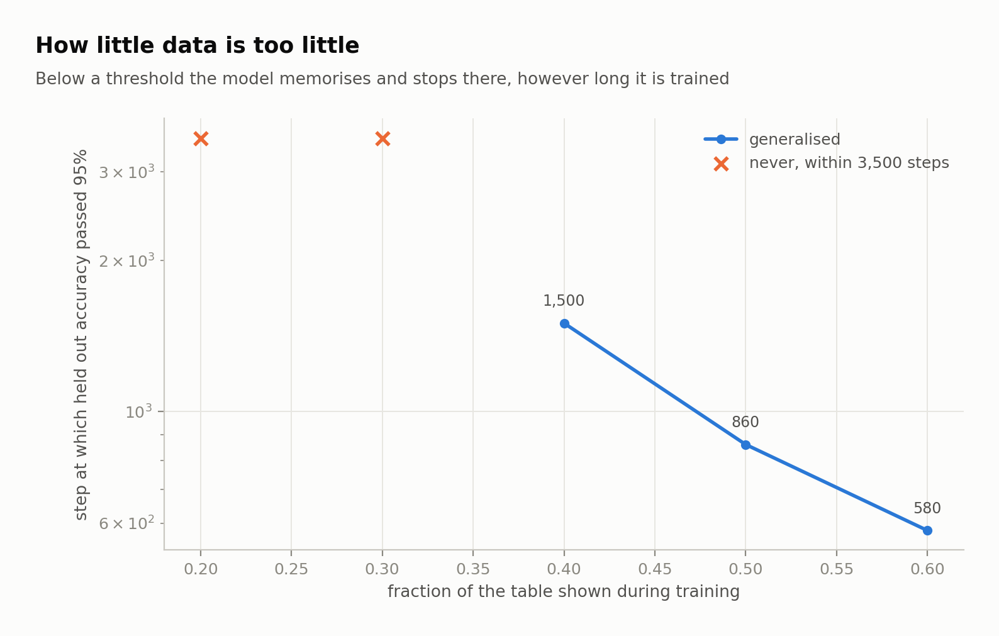
</picture>

### And it is not one lucky run

Every curve so far came from a single seed, which is the usual way a result like
this turns out to be noise. So here are six, differing only in the seed, which
changes both the initial weights and which half of the table is held out:

<picture>
  <source media="(prefers-color-scheme: dark)" srcset="figures/dark/10_seeds.png">
  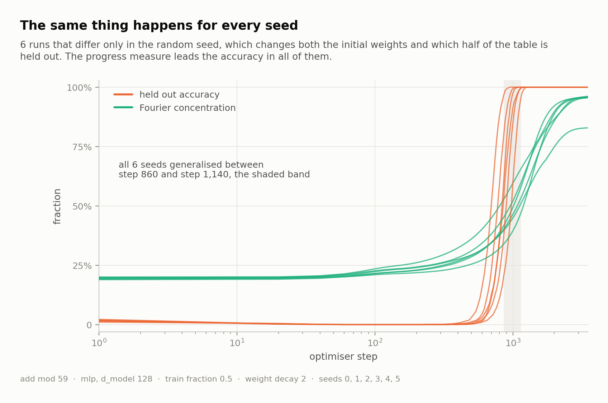
</picture>

All six generalise, between step 860 and step 1,140. In all six the Fourier
measure leaves its noise floor before held out accuracy leaves chance, by
between 320 and 420 steps, so the ordering that the whole argument rests on is
not an artefact of the one run shown earlier.

They do not agree on *which* frequencies to use: seed 0 picks 3, 5, 14 and 15,
seed 5 picks 1, 4, 16, 22 and 29. The circuit is forced; the particular circle
is not.

## Results

The five runs the figures are drawn from. The sixteen sweep points are in
[RESULTS.md](RESULTS.md) alongside these. Rebuild either with
`python scripts/report.py`.

| run | task | model | train fraction | weight decay | memorised | generalised | gap | final held out | key frequencies |
| --- | --- | --- | --- | --- | --- | --- | --- | --- | --- |
| add_p59 | add mod 59 | mlp | 0.5 | 2 | 100 | 860 | 760 steps, 9x | 1.000 | 3, 5, 14, 15 |
| div_p59 | div mod 59 | mlp | 0.5 | 2 | 100 | 1,200 | 1,100 steps, 12x | 1.000 | none |
| headline | add mod 97 | transformer | 0.3 | 1 | 125 | 5,125 | 5,000 steps, 41x | 1.000 | 19, 29, 31, 36 |
| quick_mlp | add mod 97 | mlp | 0.4 | 2 | 140 | 1,300 | 1,160 steps, 9x | 1.000 | 14, 33, 36, 38, 44, 48 |
| wide_split | add mod 97 | transformer | 0.4 | 1 | 150 | 2,550 | 2,400 steps, 17x | 1.000 | 19, 29, 31, 36, 39 |

Each of those five keeps its `config.json`, its full `metrics.jsonl`, the log
spaced embedding snapshots the Fourier analysis reads, and the final weights, so
every figure can be redrawn without retraining. The sweep points keep only their
metrics and summaries, since nothing is drawn from their weights; `make sweeps`
regenerates them in about half an hour.

## Reproducing

```bash
make test        # 88 tests, about a minute
make quick       # the MLP baseline, about twenty minutes
make headline    # the transformer run above
make sweeps      # the two sweeps
make figures     # redraw everything
make report      # rebuild RESULTS.md
```

Runs are deterministic given a seed: the split, the initialisation and the
batching are all seeded separately and the loop is full batch, so two runs of the
same config produce identical numbers. There is a test for that.

These runs are long enough that you will want to stop one. Press Ctrl-C, or
write a file called `STOP` into its run directory, and the run finalises itself
rather than throwing the last hour away: the snapshots, the weights and the
summary are all written, and `summary.json` records the step it actually
reached. Every figure then works on the shorter run.

Other tasks are one flag away: `--op sub`, `--op mul`, `--op div` (modular
division, defined through Fermat's little theorem), `--op quad` for
`a² + ab + b²`, `--op cube` for `a³ + ab`.

```bash
python -m grokking.train --config configs/div_p59.json
```

## Where the measure fails, and why

That division run is in the repository for a reason. It is the same model, the
same budget, the same weight decay, the same modulus, with only the operation
changed:

| task | memorised | generalised | key frequencies | Fourier concentration |
| --- | --- | --- | --- | --- |
| `a + b mod 59` | step 100 | step 860 | 3, 5, 14, 15 | 0.96 |
| `a / b mod 59` | step 100 | step 1,200 | none | 0.18 |

Division groks just as completely: 100% on held out pairs, from a model shown
half the table. But the Fourier concentration measure never moves. It ends at
0.18, slightly below the 0.20 it started at, and the key frequency test finds
nothing at all.

Taken at face value that says the division network generalised without building
any structure, which is not a believable thing to say about a network that
answers 1,711 unseen questions correctly. The measure is wrong, and it is wrong
in a specific way: it assumed the residues should be laid out in the order
0, 1, 2, ... , p-1.

For division there is no reason they should be. Since `a / b = a * b^(p-2)`, the
operation lives in the multiplicative group of Z_p, and that group is a circle
of a different length: pick a primitive root `g` and every non-zero residue is
`g^k` for exactly one `k` in `0 .. p-2`. On that circle, division is subtraction
of exponents, which is the same problem addition solves. So the network should
put its waves over the residues in the order 1, g, g², ... , and a measurement
taken in the usual order would see them smeared across every frequency.

Reindexing the embedding into that order and measuring again:

<picture>
  <source media="(prefers-color-scheme: dark)" srcset="figures/dark/09_two_bases.png">
  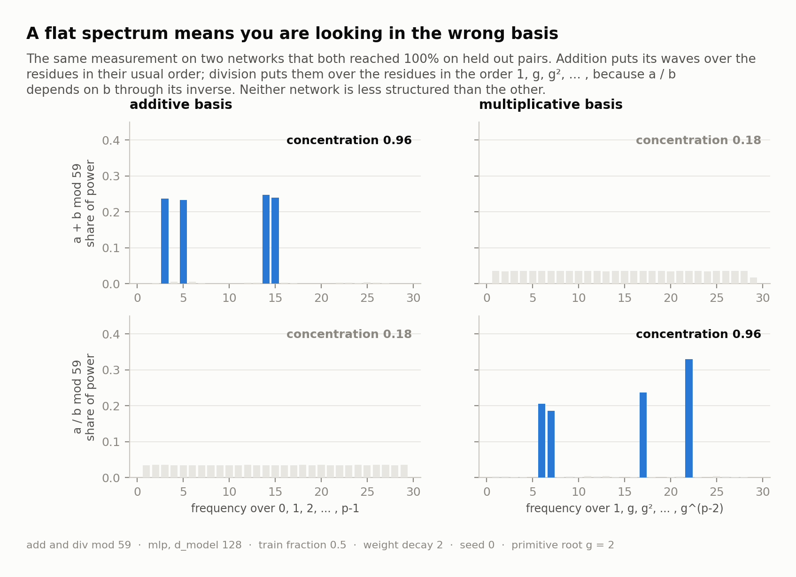
</picture>

| task | additive basis | multiplicative basis |
| --- | --- | --- |
| `a + b mod 59` | **0.96**, frequencies 3, 5, 14, 15 | 0.18, none |
| `a / b mod 59` | 0.18, none | **0.96**, frequencies 6, 7, 17, 22 |

Each network is sharply structured in its own group and looks like noise in the
other, and the two numbers are the same to two decimal places. The division
network had built its circle all along.

Two things follow, and they point in opposite directions. The encouraging one is
that the mechanism generalises past addition: grokking modular arithmetic means
finding the circle of whichever group the operation actually lives in. The
sobering one is that the measure only works when you already know which group
that is. Pointed at the wrong group it returns a confident, clean, wrong answer,
and nothing in the number itself warns you.

## What this does not show

The setting is deliberately small and clean, and that is both why the mechanism
is legible and why you should be careful generalising from it. Specifically:

* One task family, one architecture family, small p. Modular arithmetic has an
  unusually neat solution. Most tasks do not, and there is no reason to expect a
  five line closed form in the middle of a language model.
* The Fourier concentration measure predicts grokking for addition and is blind
  to it for division, as the section above shows. It is derived from knowing
  what the answer had to look like, and a measure that needs the answer in
  advance is a measurement rather than a forecast.
* The phase boundaries here are drawn at fixed accuracy thresholds (99% train,
  95% held out). They are a convention, not a physical event.
* Six seeds at p = 59, one seed everywhere else. The two transformer runs and
  the sweeps over data and weight decay are single seeded, so their exact step
  counts should be read as one draw rather than an average.

## References

The phenomenon is from Power, Burda, Edwards, Babuschkin and Misra, *Grokking:
Generalization Beyond Overfitting on Small Algorithmic Datasets* (2022). The
Fourier reading of the learned circuit, and the idea of a progress measure that
moves during the plateau, are from Nanda, Chan, Lieberum, Smith and Steinhardt,
*Progress Measures for Grokking via Mechanistic Interpretability* (2023). The
observation that weight decay is doing the work appears in several places; Liu,
Michaud and Tegmark, *Omnigrok: Grokking Beyond Algorithmic Data* (2023) makes
the case most directly.

The implementation here is independent. No code was taken from those papers.

## Licence

MIT. See [LICENSE](LICENSE).
